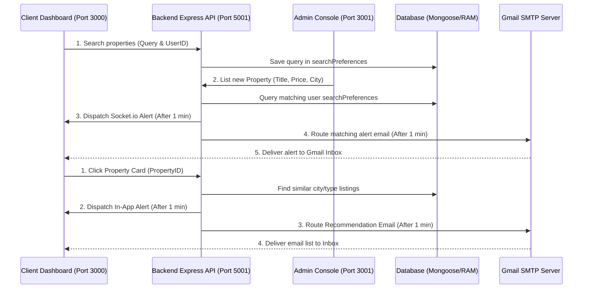

# Renting Carnival - Notification System Monorepo 🔔

This directory contains a separate MERN project that splits the customer application, admin console, and websocket notification server into three independent services.

---

## 📂 Directory Layout

1. **`server/`** (Runs on port **5001**):
   - Express backend incorporating REST endpoints and Socket.io.
   - Dual-Mode database using Mongoose (MongoDB) with a local memory state fallback if MongoDB is not running on the system.
   - Mail simulator and SMTP services.
2. **`client/`** (Runs on port **3000**):
   - React customer portal copied from the original `src/Main` folder.
   - Real-time notification Bell dropdown in the navbar.
   - Floating simulator panel drawer on the homepage to trigger search matches, wishlist restocks, and expired lease alerts.
3. **`admin/`** (Runs on port **3001**):
   - Independent React dashboard for administrator actions.
   - Triggers blogs alerts, custom users notifications, account termination notices, and restsock triggers.
   - Built-in outgoing email HTML preview list.

---

## 🚀 Running the Services

Launch all three services concurrently from this directory (`notification-system`):

```bash
npm run dev
```

* **Customer Portal URL**: `http://localhost:3000`
* **Admin Dashboard URL**: `http://localhost:3001`
* **Server REST API URL**: `http://localhost:5001`

---

## 🔔 Notification & Email Flow System (Hinglish Guide)

Hamare system me do type ki notifications work karti hain:
1. **In-App Notification**: Websockets (Socket.io) ke throw user screen par directly dynamic logs create aur bell update karti hai.
2. **Email Alert**: SMTP (Nodemailer via Gmail/Ethereal) ke through directly user ke real inbox me emails deliver karti hai.

---

### 1. Jab User Property Search Karta Hai (Search Alert Flow)
* **Step 1**: Jab user client page par kisi propery keyword (like 'Delhi', '2BHK') ko search bar me daal kar search button click karta hai, tab client backend API `POST /api/properties/search` ko hit karta hai.
* **Step 2**: Backend automatic us user document ke `searchPreferences.lastSearchQuery` field me ye keyword save kar deta hai.
* **Step 3**: Agli baar jab admin Admin Console se naya property add karta hai (`POST /api/properties`), tab backend loop chala kar saare users ke `lastSearchQuery` se match check karta hai.
* **Step 4**: Agar match ho jata hai, tab backend **1 minute ke delay (`setTimeout`)** ke baad user ko in-app notification aur real email "New Matching Property Listed!" inbox me bhej deta hai.

---

### 2. Jab User Kisi Property Par Click Karta Hai (Click Recommendation Flow)
* **Step 1**: Customer jab portal par kisi property card par click karta hai, tab frontend automatic `POST /api/properties/click` hit karta hai.
* **Step 2**: Backend check karta hai ki clicked property ka layout type kya hai (e.g., 2BHK) aur city kaunsi hai (e.g., Delhi).
* **Step 3**: Database se similar listings ko retrieve kiya jata hai (excluding the clicked property).
* **Step 4**: **1 minute ke delay** ke baad:
  - User ke real registerd Gmail inbox me standard HTML template ke sath list bhej di jati hai.
  - In-app Bell icon ke notifications log me "Interested in this property?" alert add kar diya jata hai.

---

### 3. Back-in-Stock Notice (Furniture Alerts)
* **Step 1**: Agar koi furniture item out-of-stock (false) hai, to client screen par "Alert Me" button show hota hai.
* **Step 2**: User jab "Alert Me" click karta hai, tab `POST /api/furnitures/wishlist` API hit hoti hai aur user profile ke `wishlistedFurniture` array me us product ki ID add ho jati hai.
* **Step 3**: Jab admin panel se admin stock details ko edit karke wapas "In Stock" (yes) par update karta hai, tab backend check karta hai ki kis-kis user ke array me ye furniture ID present hai.
* **Step 4**: Sabhi wishlisted users ko in-app Restock notice mil jata hai aur ek back-in-stock email trigger ho jata hai.

---

### 4. Blog Publishing System
* **Step 1**: Admin jab console se naya article compose karke "Publish" click karta hai, tab api `POST /api/blogs` hit hoti hai.
* **Step 2**: Backend article ko save karta hai aur loop chala kar sabhi non-admin users ko active update push karta hai.
* **Step 3**: Users ke screen par log tab me real-time notification update dikhta hai.

---

## 📊 Data Flow Architecture Map (Diagram)


# NotificationSysytem
